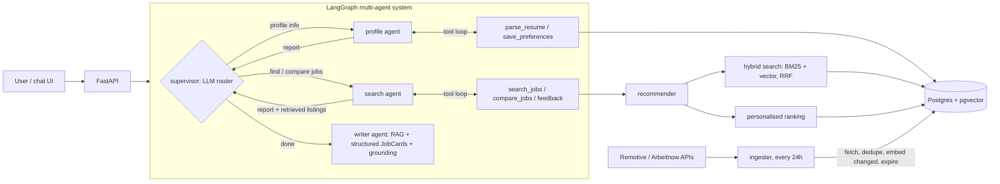

# InternMate: Conversational AI Internship Finder

A chat-based career agent that helps students find internships. It learns a student's skills and preferences from conversation (or their resume), searches a constantly refreshed job index with **hybrid semantic search**, **ranks results personally**, and explains why each job fits and which skills are missing.

**Stack:** Python · FastAPI · LangGraph · Gemini (tool calling + structured outputs) · PostgreSQL + pgvector (SQLite fallback) · BM25 · Docker

---

## Features

- **Multi-agent LangGraph system with conditional routing.** A **supervisor** (an LLM router with structured output) decides which specialist acts next:
  - **Profile agent:** resume analysis and saving preferences. Tools: `parse_resume`, `save_preferences`, `get_my_profile`.
  - **Search agent:** semantic job search, comparison and feedback. Tools: `search_jobs`, `compare_jobs`, `record_feedback`.
  - **Writer agent (RAG):** writes the final answer using only the listings retrieved this turn.

  Each specialist runs its own tool loop in a private scratchpad and reports back to the supervisor. Handoff and tool-step limits prevent infinite loops.
- **Structured, grounded outputs.** Recommendations are returned as Pydantic `JobCard`s. A grounding step drops any job the writer mentions that wasn't retrieved, and replaces title, company and URL with the database values, so the system cannot invent listings.
- **Memory.**
  - Short-term: the conversation thread, stored by a LangGraph checkpointer.
  - Long-term: the `users` table (skills, roles, locations, stipend). Every search reads it for ranking.
- **Hybrid retrieval.** BM25 keyword search and embedding search, fused with Reciprocal Rank Fusion.
- **Personalised ranking.** Combines search relevance, skill overlap, preference match and similarity to jobs the user 👍/👎'd.
- **Live, changing index.** Ingestion from the Remotive and Arbeitnow APIs, with:
  - de-duplication across sources
  - content hashing, so only changed listings are re-embedded
  - expiry of jobs that vanished or got too old
  - an `ingestion_runs` audit table
  - per-source failure isolation: a failing API never wipes its jobs
- **Evals.** Recall@k, MRR and nDCG over a labelled query set comparing four retrieval strategies, plus an optional LLM-as-judge.

## Architecture



## Database schema

| Table | Purpose | Key columns |
|---|---|---|
| `jobs` | The job index | `dedupe_key` (unique), `content_hash`, `is_active` (indexed), `embedding` (pgvector, HNSW index), `last_seen_at` |
| `users` | Profile = long-term memory | `skills`, `preferred_roles`, `preferred_locations`, `remote_only`, `min_salary` |
| `feedback` | 👍/👎 signals | unique (`user_id`, `job_id`) |
| `ingestion_runs` | Refresh audit log | counts inserted / updated / unchanged / expired, `errors` |

## Ranking

```
score = 0.55 · relevance  (hybrid search, min-max normalised)
      + 0.25 · skills     (share of the job's skills the user has)
      + 0.12 · preference (role / location / remote / stipend met)
      + 0.08 · feedback   (similarity to liked jobs − similarity to disliked jobs)
```

Signals with no data are neutral (0.5), so a new user gets plain relevance ranking.

## Evaluation

`evals/queries.json` holds 25 queries with hand-labelled relevant jobs from the bundled sample set. Six of them include a user profile, to test personalisation.

```bash
python -m internmate.cli eval            # retrieval metrics
python -m internmate.cli eval --judge    # + LLM-as-judge (needs GOOGLE_API_KEY)
```

Results with `EMBEDDING_PROVIDER=hash` (the offline fallback, which only captures word overlap):

| Method | Recall@5 | Recall@10 | MRR | nDCG@10 |
|---|---|---|---|---|
| keyword (BM25) | 0.86 | 0.86 | 0.873 | 0.845 |
| vector | 0.81 | 0.92 | 0.865 | 0.829 |
| hybrid (RRF) | 0.84 | 0.94 | 0.891 | 0.871 |
| hybrid + personalised | 0.94 | 0.97 | 0.953 | 0.922 |

> Results with Gemini embeddings: _run `eval` with `EMBEDDING_PROVIDER=gemini` and paste them here._
> Caveat: it's a small, self-labelled set of 30 jobs and 25 queries. Treat it as a regression check, not a benchmark.

## Getting started

```bash
python -m venv .venv
.venv\Scripts\activate          # Windows  (macOS/Linux: source .venv/bin/activate)
pip install -r requirements.txt
```

Create a `.env` file in the project root:

```env
GOOGLE_API_KEY=your-gemini-api-key-here      # free: https://aistudio.google.com/apikey
DATABASE_URL=sqlite:///./internmate.db
LLM_MODEL=gemini-2.5-flash
EMBEDDING_PROVIDER=gemini                    # or "hash" to run fully offline
EMBEDDING_MODEL=gemini-embedding-001
EMBEDDING_DIM=768
JOB_MAX_AGE_DAYS=30
```

```bash
python -m internmate.cli ingest --source sample remotive arbeitnow   # build the index
python -m internmate.cli search "python llm internship"              # ranked search, no LLM
python -m internmate.cli chat --user me                              # talk to the agent
uvicorn internmate.api:app --reload                                  # web UI at http://localhost:8000
pytest                                                                # 23 tests, run offline
```

**With Docker (Postgres + pgvector, API and daily ingester):**

```bash
docker compose up --build
```

> If you change `EMBEDDING_PROVIDER` or `EMBEDDING_DIM`, delete the database (or drop `jobs`) and re-ingest, because stored vectors must match the query embedder.

## API

| Method | Path | Description |
|---|---|---|
| POST | `/chat` | `{user_id, message}` → `{message, recommendations: [JobCard]}` |
| GET | `/jobs/search?q=&user_id=&remote_only=&location=&min_salary=&k=` | Ranked search with a score breakdown |
| GET/PUT | `/profile/{user_id}` | Read or update the remembered profile |
| POST | `/feedback` | `{user_id, job_id, liked}` |
| POST | `/ingest` | `{sources: ["sample", "remotive", "arbeitnow"]}` |

## Tests

The tests run fully offline. The multi-agent graph is tested with a scripted fake LLM covering supervisor routing, specialist tool loops, the handoff limit, per-turn RAG context resets, memory persistence and removal of hallucinated jobs.

## Limitations and next steps

- **Data:** the live sources are mostly US and EU remote roles. Indian internship boards would need their own connectors.
- **Keyword index:** BM25 is in-memory and rebuilt when the index changes. At larger scale, move it to Postgres full-text search.
- **Memory:** conversation memory uses an in-memory checkpointer and resets on restart. The next step is the LangGraph Postgres checkpointer.
- **Ranking:** the weights are hand-tuned. Next, learn them from feedback (learning-to-rank) and add cross-encoder re-ranking.
- **Search:** add query rewriting by the LLM (e.g. "AI internships" → expanded skill terms).
